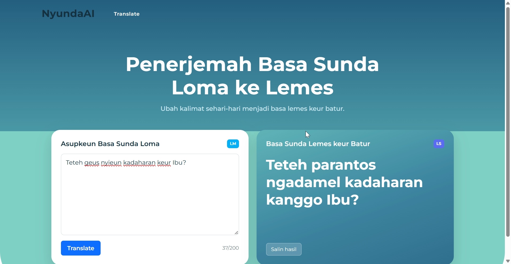

# 🗣️ NyundaAI — Sundanese Speech-Level Translator (Loma → Lemes)

A **Sundanese speech-level translation system** that rewrites everyday Sundanese (*basa loma*) into polite Sundanese addressed to someone else (*basa lemes keur batur*). Built with a **custom parallel dataset**, a **dictionary-based baseline**, a **fine-tuned ByT5 sequence-to-sequence model**, honest evaluation with error analysis, and a **Flask web interface**.

Sundanese is a low-resource language in NLP, and its *undak-usuk basa* (speech levels) depends on who is speaking and who is being spoken about. This project explores how far a small model can go with a small, hand-built dataset.

     




---

## ✨ Key Features

- **Speech-Level Translation** — Converts *loma* sentences into *lemes keur batur* (e.g., *Bapa geus dahar?* → *Bapa parantos tuang?*), including mixed sentences where the speaker's own words switch to *lemes keur sorangan* (e.g., *Abdi parantos neda, Bapa badé tuang naon?*).
- **Custom Parallel Dataset** — 300 hand-structured sentence pairs with explicit addressee (*Bapa, Ibu, Akang, Teteh, Aki, Nini, Pa Guru, Mamang, Bibi*), sentence type (question, statement, command, prohibition), a flag for mixed-level sentences, and a fixed train / val / test split.
- **Dictionary Baseline** — Rule-based word substitution with a 92-entry lexicon, plus clause-level rules for the speaker's own words and for *keur* meaning "for" versus "currently".
- **Fine-Tuned ByT5-small** — Character-level seq2seq model trained with PyTorch and Hugging Face Transformers, with best-checkpoint selection on validation chrF++.
- **Leak-Aware Evaluation** — chrF++, BLEU, and exact match, reported on a held-out test set and on the subset of test sentences containing words never seen in training.
- **Error Analysis** — Failures are grouped by cause (rare vocabulary, over-editing of words that should stay unchanged, hallucinated characters).
- **Flask Web Interface** — Two-panel translator UI with clickable example sentences, character counter, copy button, input validation, and loading state.

---

## 📊 Results

Evaluated on the **40 test sentences added after the first lexicon was built** (ids > 100), so the first dictionary version has never seen them. Since the trained model is not distributed, every number below can be inspected through the per-sentence outputs in `results/` (`predictions_baseline.csv`, `predictions_finetune.csv`, `hasil_finetune.csv`, `training_log.csv`).

| System | chrF++ | BLEU | Exact match |
|---|---|---|---|
| Copy source (no change) | 36.4 | 13.1 | 0.0% |
| Dictionary baseline v1 (built from the first 100 pairs) | 89.7 | 81.8 | 57.5% |
| **Fine-tuned ByT5-small** | **94.6** | **91.8** | **80.0%** |
| Dictionary baseline v2 (extended with words from the training split) | 99.6 | 99.5 | 97.5% |

**On test sentences containing words not present in the training set** (13 sentences):

| System | chrF++ | Exact match |
|---|---|---|
| Dictionary baseline v1 | 90.0 | 61.5% |
| Fine-tuned ByT5-small | 86.7 | 61.5% |
| Dictionary baseline v2 | 96.5 | 84.6% |

### How to read these numbers

- The fine-tuned model clearly beats the first dictionary and the copy baseline, so it learned real patterns from the data.
- **It does not beat the extended dictionary (v2).** The dataset vocabulary is narrow and repetitive, which favors a lookup table that memorizes each word once.
- The 13-sentence subset is too small to claim generalization to new words. One sentence moves exact match by about 7.7 points, and results come from a single training run.

### Error analysis (10 wrong test sentences)

| Cause | Count | Example |
|---|---|---|
| Rare or unseen word (0 to 2 occurrences in train) | 7 | *Huntu* left unchanged instead of *waja*; *leumpang* wrongly changed to *lepat*; *Masakan* corrupted into *Mastaka* |
| Wrong substitution of a frequent word | 2 | *dahar* → *nyandak* instead of *tuang* |
| Inserted extra word | 1 | *Ibu terang nami **parantos** guru énggal?* |

The main bottleneck is **vocabulary coverage**, not the model size: most problem words appear in training fewer than three times. A character-level model also tends to **over-edit** unfamiliar words that should have stayed unchanged.

---

## 🗂️ Dataset

| Column | Description |
|---|---|
| `id` | Row identifier |
| `sumber_loma` | Input sentence in *loma* |
| `target_lemes_batur` | Reference sentence in *lemes keur batur* |
| `sapaan` | Addressee mentioned in the sentence |
| `tipe_kalimat` | Question / statement / command / prohibition |
| `campuran_sorangan` | Whether the sentence also contains the speaker's own *lemes* forms |
| `split` | `train` (220), `val` (30), `test` (50) |

**Scope:** short single sentences with an explicit addressee, direction *loma → lemes keur batur* only.

> ⚠️ **Data quality note:** the sentence pairs were drafted with LLM assistance and have **not** been formally validated by multiple native speakers. Word choices may vary across Sundanese regions. Treat the dataset as a prototype, not a linguistic reference.

---

## 🛠️ Tech Stack

- **Language:** Python
- **Modeling:** PyTorch, Hugging Face Transformers, ByT5-small (about 300M parameters)
- **Evaluation:** sacreBLEU (chrF++, BLEU), pandas
- **Training Environment:** Google Colab (T4 GPU), about 10 minutes for 40 epochs
- **Web App:** Flask, HTML, CSS, vanilla JavaScript

---

## 📁 Project Structure

```
sunda-translator/
├── data/
│   ├── dataset_sunda_loma_lemes_v2.csv
│   ├── kamus_sunda_loma_lemes_v1.csv
│   └── kamus_sunda_loma_lemes_v2.csv
├── notebooks/
│   └── finetuning_sunda.ipynb    
├── src/
│   └── baseline.py                   
├── results/                          
├── app/
│   ├── app.py                        
│   ├── templates/index.html
│   └── static/ (style.css, script.js)
├── requirements.txt
└── README.md

```

---

## 🚀 Getting Started

### Prerequisites

- [Python](https://www.python.org/) 3.10 or higher
- pip
- About 1.5 GB of free disk space for the model
- A GPU is only needed for training (the free Colab T4 is enough); the web app runs on CPU

### Installation & Local Setup

1. **Clone the repository:**
   ```bash
   git clone https://github.com/fadlanfatardilla/sunda-translator-flask.git
   cd sunda-translator-flask
   ```

2. **Install dependencies:**
   ```bash
   pip install -r requirements.txt
   ```

3. **Run the dictionary baseline** (optional):
   ```bash
   python src/baseline.py
   ```
   Scores are written to `results/hasil_baseline.csv`.

4. **Train the model.** The trained model (about 1 GB) is **not distributed** with this repository. It is reproducible in roughly 10 minutes on the free Colab GPU:
   - Open `notebooks/finetuning_sunda.ipynb` in [Google Colab](https://colab.research.google.com/) (**File → Upload notebook**) and set the runtime to **T4 GPU**.
   - Run all cells and upload `data/dataset_sunda_loma_lemes_v2.csv` (and, optionally, `results/predictions_baseline.csv`) when asked.
   - Download the saved `best_model` folder (the last cell can copy it to Google Drive) and place it in `models/best_model/`.

   Results can vary by a few points between runs, since the dataset is small and training uses a single seed.

5. **Start the web app** (requires the model from step 4):
   ```bash
   python app/app.py
   ```
   Open [http://127.0.0.1:5000](http://127.0.0.1:5000) in your browser.

---

## ⚠️ Limitations & Future Work

- **Small and narrow dataset.** 220 training sentences with repeated vocabulary; most errors come from rare words.
- **Unvalidated labels.** Pairs have not been checked by several native speakers.
- **One direction and one level.** Only *loma → lemes keur batur*; the reverse direction and very high registers (*lemes pisan*) are out of scope.
- **Short, single sentences.** Long or compound sentences, proverbs, and regional dialects are not covered.
- **Planned improvements:** expand the dataset so each word appears in several contexts (including words that must stay unchanged), validate with multiple speakers, compare against NLLB-200 and few-shot LLM prompting, and combine the dictionary with the model to reduce hallucinated words.

---

## 📄 License

Add your license here (for example MIT).
